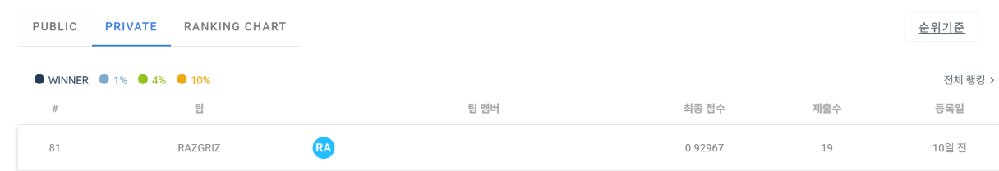
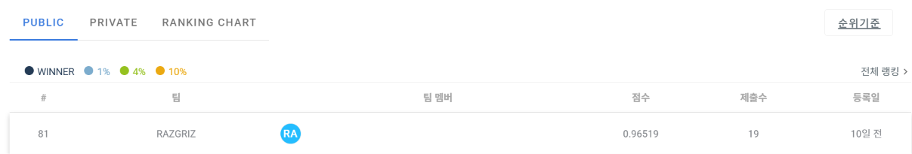

# 입항 기록 ↔ 선박 카탈로그 매칭 — Private 81위 / 468팀 솔루션

**[DACON 항만 문제해결을 위한 AI 기술 공모전](https://dacon.io/competitions/official/236771)**(2026.10.22 \~ 11.01 참가, 개인) · 후보 검색 + 순위 학습 + 한글 음역 비교


[](LICENSE)

항만 입항 기록 한 행(선박명·호출부호·톤수·국적·선종·입항 연도)을 공식 선박 카탈로그 **78,595척 가운데 하나의 `vessel_id`에 연결하는 개체 매칭** 과제입니다.
점수의 70%를 차지하는 한글 선박명 행은 영문뿐인 카탈로그와 바로 비교할 수 없고, test 한글 이름에는 음절 오타와 톤수 결측이 섞여 있었습니다.
그래서 순위 모델을 다듬기보다 **정답을 후보에 넣는 검색**과 **어느 공간에서 이름을 비교할지**를 바꾸는 데 집중했고, 마지막 0.948 → 0.965는 재학습 없이 얻었습니다. 노트북 GPU(8GB) 한 장으로 진행했습니다.

| | Public | Private (최종 순위) |
|---|---|---|
| 첫 제출 (공식 베이스라인) | 0.3616 | — |
| **최종 제출 (v21b)** | **0.96519 (81위)** | **0.92967 (81위 / 468팀)** |

**Private 리더보드 (최종 순위)**



**Public 리더보드**



### 핵심 성과

- **실패를 '후보 누락'과 '순위 밀림'으로 나눠 3일 정체를 깸**: train 영문 이름에 남은 주최 측 오타 흔적으로 test 노이즈를 다시 추정했습니다.
  오답의 67%는 정답이 후보 목록에 아예 없었고, 편집 거리 퍼지 검색으로 후보를 보강해 Public 0.910 → 0.948이 됐습니다(재학습 없음).
- **비교 방향 뒤집기**: 오타는 한글 음절에서 생기는데, 파이프라인은 한글을 영문으로 음역한 뒤 비교하고 있었습니다.
  카탈로그 7.8만 개 이름을 LLM으로 **미리 한글로 음역**해 한글끼리 비교하자 Public 0.948 → 0.965가 됐습니다.
- **점수를 정답 수로 분해**: `점수 = 0.7 × 한글/532 + 0.3 × 비한글/3,568`의 해가 제출마다 하나뿐이라, 변경마다 어느 쪽이 몇 행 움직였는지 정확히 읽었습니다.
  10번의 제출 동안 비한글 정답 수가 묶여 있던 것을 찾아 영문 퍼지 후보로 +19행을 더했습니다.
- **서버 제약 안의 엔지니어링**: L4 30분·행 독립 규칙 아래에서 LLM 음역과 신경망 재판별이 든 6.6GB 패키지를 12분대에 실행했습니다.
  제출 전마다 형식·행 독립성·실행 시간을 자동으로 검사해, 19회 제출이 모두 정상 채점됐습니다.

> 📊 [제출 기록](experiments/submissions.md) — 제출 19회의 구성, 준비 당시 로컬 검증, Public 점수와 해석

> 📑 [v13\~v18 퍼지 검색](docs/fuzzy_retrieval_20261030.md) · [v19\~v21b 한글 공간 비교](docs/hangul_space_20261101.md) · [정체기 실험](docs/performance_summary_20261029.md) · [작업 로그](docs/portfolio_log.md)

---

## 목차

1. [문제 정의](#1-문제-정의)
2. [데이터 분석](#2-데이터-분석)
3. [솔루션 구조](#3-솔루션-구조)
4. [핵심 기법](#4-핵심-기법)
5. [결과](#5-결과)
6. [주요 의사결정](#6-주요-의사결정)
7. [실패에서 배운 것](#7-실패에서-배운-것)
8. [회고](#8-회고)
9. [실행 방법](#9-실행-방법)
10. [재현성](#10-재현성)
11. [공개 범위](#11-공개-범위)

---

## 1. 문제 정의

| | |
|---|---|
| 과제 | 입항 기록 1행 → 공식 카탈로그 78,595척 중 하나의 `vessel_id` |
| 평가 지표 | `0.7 × 한글 선박명 행 정확도 + 0.3 × 비한글 행 정확도` (Public: test 일부 / Private: 최종 순위) |
| 데이터 | train 12,222행 (한글 1,191행·382척, 9.7%) / 카탈로그 78,595척 (선박명은 모두 영문) / test 행 수 비공개 |
| 입력 열 | 선박명, 호출부호(해시), 총톤수·국제총톤수, 국적, 선종, 입항 연도 |
| 주요 규칙 | 코드 제출(L4 GPU, 추론 30분), **행 독립 예측**(다른 test 행의 정보 사용 금지), 외부 데이터 금지, 공개 사전학습 가중치만 허용 |
| 장비 | RTX 5060 Ti 16GB (10/22\~29) → RTX 5060 Laptop 8GB (10/30\~), Windows 11 |

```
(입력)    한글 선박명 + 호출부호·톤수·국적·선종·입항 연도         예) 글로비스 슈프림
(정답)    영문 카탈로그의 vessel_id                                예) Glovis Supreme
(어려움)  test 한글에는 음절 오타(삭제·중복·순서 바뀜)와 톤수 결측이 있지만, train 한글에는 없음
```

---

## 2. 데이터 분석

모델보다 데이터를 먼저 측정했고, 여기서 나온 세 가지가 전략을 정했습니다.

**① 한글 행이 문제의 거의 전부입니다.** 한글 기록은 train의 9.7%뿐이지만 점수의 70%를 차지합니다.
비한글 행은 첫 순위 모델에서 이미 정확도 0.998이었고, 공식 베이스라인은 한글 행의 후보 recall부터 68.6%에 그쳤습니다.
한글 이름에는 영어·로마자·약어 읽기(`케이엠티씨 하이퐁` → KMTC Haiphong), 붙여쓰기, `호` 접미사가 섞여 있었습니다.

**② train 한글은 깨끗하지만 test 한글은 망가져 있습니다.** CV 한글 정확도는 0.966인데 Public으로 역산한 test 한글은 0.63 정도였습니다.
train 한글 행에는 오타도 톤수 결측도 없었습니다. 대신 주최 측은 train **영문** 이름에 일부러 오타를 넣어 두었고, 같은 선박의 모든 행에 같은 오타가 들어 있었습니다.
5,471척을 카탈로그와 비교해 노이즈를 직접 측정했습니다.

| 항목 | 값 |
|---|---|
| 오타가 있는 선박 | 38% (1글자 25%, 2글자 11.5%, 3글자 이상 1.5%) |
| 오타 종류 | 글자 삭제, 글자 중복, 인접 글자 순서 바뀜 |
| 단어 생략 | **0건** (그전까지 쓰던 합성 지표는 단어 생략을 23%로 가정) |
| 결측 | 톤수 7.2%, 국적 17% |

같은 생성기가 test 한글에 음절 단위로 적용됐다고 보고 평가 세트를 다시 만들었습니다. 4\~5음절인 한글 이름에서 한 음절 오타는 이름의 20%를 바꿉니다.

**③ test 선박은 train 선박과 겹치지 않습니다.** train의 호출부호 → 선박 조회를 넣은 제출(v13)이 직전 제출과 소수점 10자리까지 같았습니다.
test에 train과 같은 호출부호가 하나도 없다는 뜻이라, train에 나온 선박 5,851척을 정답 후보에서 뺐습니다.

---

## 3. 솔루션 구조

"**정답을 후보에 넣는 검색**과 **한글·영문 양쪽 공간에서의 비교**"가 핵심입니다. 순위 모델은 v18에서 고정했습니다.

```
입항 기록 1행 (선박명·호출부호·톤수·국적·선종·입항 연도)  →  카탈로그 78,595척 중 하나
  │
  ├─ ① 미리 만든 표 (카탈로그·train만 사용, 제출 전에 한 번)
  │     카탈로그 이름 → 한글 음역: 탐욕 1개 + 빔 4개 (Kanana-1.5-2.1B few-shot, 공개 원본 가중치)
  │     train에 나온 선박 5,851척 목록 (test 선박과 겹치지 않으므로 후보에서 제외)
  │
  ├─ ② 후보 검색 (행마다 독립)
  │     공통 : 문자 n-gram TF-IDF(단어 100 · 공백 제거 100) · 정확 일치 · 톤수 근접 30 · 단어 포함(약칭)
  │     한글 : 발음 키(자음 골격) TF-IDF · LLM 영문 음역 4개로 검색 (배치 1, 행 독립)
  │            + 퍼지   : 발음 키·음역 ↔ 카탈로그 Indel 편집 거리 상위 500씩
  │            + 오타 되돌림 : 인접 음절 순서·중복 음절을 되돌린 이름의 발음 키 일치
  │            + 한글 공간 : 질의 ↔ 카탈로그 한글 음역(최대 5개 변형 중 최댓값) Indel 상위 50
  │     영문 : 카탈로그 이름(공백 제거)과 Indel 편집 거리 상위 50
  │     → train 선박은 후보에서 제외
  │
  ├─ ③ 순위 학습 (특징 78개: 문자열·발음 키·음역 유사도, 톤수 차, 국적·선종 대응 확률 …)
  │     CatBoost YetiRank 400회 × 시드 3 (각 가중 3)
  │     LightGBM LambdaRank 150회 × 시드 2 (각 가중 1)
  │     선박 단위 GroupKFold 검증, 톤수 결측·오타·약칭 증강 → 그룹 내 확률의 가중 평균
  │
  ├─ ④ 한글 공간 보정 (한글 행)
  │     log p + 6 × 한글 유사도      ← 재학습 없음, 노이즈 세트로 가중치 선택
  │
  └─ ⑤ 신경망 재판별 (한글 행, 상위 20개)
        Qwen3-Reranker-0.6B 12.5% + 발음 키 입력 BGE-reranker-v2-m3 12.5% + ④까지의 확률 75%
        → 1위 후보의 vessel_id      (L4 서버 12분 15초 / 제한 30분)
```

- **한글 ↔ 영문 두 방향**: 한글 질의를 영문으로 옮기는 경로(발음 키, LLM 음역)와 카탈로그를 한글로 옮기는 경로(①의 음역표)를 함께 씁니다.
- **행 독립**: 모든 검색·특징·분기는 그 행의 입력과 고정된 산출물만 씁니다. 행 순서를 섞거나 한 행만 실행해도 결과가 같은지 제출 전마다 검사했습니다.
- **패키지 소스 해시 검사**: 재판별기 설정에 소스 파일 해시가 기록돼 있어 핵심 모듈을 직접 고칠 수 없습니다. v15 이후의 검색 변경은 모두 `script.py`에서 검색 함수를 감싸는 방식으로 넣었습니다.

---

## 4. 핵심 기법

### 4-1. 한글과 영문을 같은 공간으로 — 발음 키와 LLM 음역

- **발음 키**: 한글과 영문을 모두 자음 골격으로 바꿔 비교합니다(`모닝`·`Morning` → `MNN`). OOF 한글 정확도 0.41 → 0.97, Public 0.50 → 0.74.
- **LLM 음역**: 공개 소형 LLM 5종을 비교해 Kanana-1.5-2.1B를 골랐고, 한글 이름마다 영문 음역 후보 4개를 만들어 검색과 특징에 씁니다. Public 0.83 → 0.90.
- 배치로 생성하면 같은 이름도 실행마다 결과가 달라지는 것을 발견했습니다. 행 독립 규칙을 지키려고 **배치 크기를 1로 고정**했고, 서버 시간 예산은 여기에 맞춰 짰습니다.
- Kanana를 train 쌍(1,619개)으로 LoRA 미세조정하면 오히려 나빠져(검색 상위 10위 적중 0.932 → 0.838) 원본 가중치를 그대로 썼습니다.

### 4-2. 노이즈 증강 학습

train 한글 행에는 톤수 결측이 0%였습니다. 학습 한글 선박에 톤수 결측·오차, 오타, 약칭을 넣은 **스트레스 테스트**로 약점을 측정했고,
같은 변형으로 증강해 학습했습니다. 톤수가 없는 행의 정확도가 0.54 → 0.86, Public 0.74 → 0.83이 됐습니다.

### 4-3. 순위 학습 앙상블과 신경망 재판별

- LightGBM의 하이퍼파라미터·목적함수를 바꾸거나 변형끼리 섞는 것은 ±0.002에 그쳤습니다. 입력이 같으면 같은 곳에서 틀리기 때문입니다. 알고리즘이 다른 CatBoost YetiRank를 섞어야 효과가 났습니다.
- 한글 행 상위 20개 후보를 **Qwen3-Reranker-0.6B**와 발음 키를 입력으로 받는 **BGE-reranker-v2-m3**로 다시 판별합니다. 둘 다 LoRA(rank 8)로 학습한 뒤 병합했습니다(2,400그룹, 1에폭).
- 이 단계의 이득은 Public 0.8998 → 0.9066으로 작았습니다. 이후 개선은 모두 검색 쪽에서 나왔습니다.

### 4-4. train 선박 제외

호출부호 조회 제출(v13)의 결과가 그대로였다는 것은 test 선박이 train과 겹치지 않는다는 증거였습니다.
선박 단위 CV에서 "학습 fold 선박을 후보에서 제외"하면 이 상황을 재현할 수 있었고, 합성 평가 세트에서 0.9050 → 0.9239가 됐습니다. Public 0.9066 → 0.9096.

### 4-5. 오타에 강한 후보 검색 — 퍼지 검색과 오타 되돌림

학습 한글 200척에 오타를 넣고 톤수를 지우자 정확도가 0.82\~0.92로 떨어졌습니다. 실패 114건 중 **76건(67%)은 정답이 후보 목록에 없었습니다.**
오타가 발음 키와 LLM 음역을 함께 비틀고, 톤수가 없으니 톤수 검색도 쓸 수 없었기 때문입니다. 놓친 정답을 검색 방식별로 다시 찾아봤습니다.

| 검색 방식 | 정답이 상위 20 안에 든 수 (114건 중) |
|---|---:|
| LLM 음역 TF-IDF (기존) | 19 |
| 발음 키 ↔ 카탈로그 발음 키, Indel 편집 거리 | 45 |
| **LLM 음역 ↔ 카탈로그 이름, Indel 편집 거리** | **64** |

이 두 퍼지 검색의 상위 K개와, 인접 음절 순서·중복 음절을 되돌린 이름의 발음 키 검색을 후보에 더했습니다. 순위 모델은 다시 학습하지 않았습니다.

| 버전 | 변경 | Public |
|---|---|---:|
| v15 | 퍼지 후보 20개 | 0.9228 (+0.0132) |
| v16 | 퍼지 후보 50개 | 0.9333 (+0.0105) |
| v17 | 퍼지 후보 200개 + 오타 되돌림 | 0.9452 (+0.0118) |
| v18 | 퍼지 후보 500개 | 0.9478 (+0.0026) |

### 4-6. 비교 방향 뒤집기 — 카탈로그 한글 음역표 (v20)

v18의 노이즈 세트 오답 268건을 직접 읽었습니다. 88%는 정답이 후보 안에 있었고, 상당수는 사람이 보면 바로 되돌릴 수 있는 오타였습니다.
파이프라인은 한글 질의를 영문으로 음역해서 비교합니다. 그런데 음절 순서만 바뀌어도 영문 음역은 완전히 달라지므로, 영문 공간에서는 "한 음절 차이"라는 정보가 사라집니다.

그래서 카탈로그 영문 이름 78,594개를 같은 Kanana 모델로 **미리 한글로 음역**해 표로 넣고, 한글 질의와 한글끼리 비교했습니다.
표는 카탈로그만으로 만들기 때문에 행 독립 규칙과 무관하고, 서버 실행 시간도 거의 늘지 않습니다.

| 질의 (오타) | 정답 | 카탈로그 한글 음역 | 한글 공간 Indel 유사도 |
|---|---|---|---:|
| 아한라 | Arahan | 아라한 | 0.67 |
| 우진진 | Woo Jin | 우진 | 0.80 |
| 터헌 | Hunter | 헌터 | 0.50 |

한글 유사도는 두 곳에 씁니다. 한글 공간 편집 거리 상위 50개를 후보에 더하고, 신경망 재판별 전에 `log p + KO_W × 유사도`로 순위를 보정합니다.

| 평가 | v18 방식 | v20 (KO_W 4) |
|---|---:|---:|
| 5-fold 노이즈 세트 (기본 순위 모델) | 0.8875 | 0.9173 |
| 전체 파이프라인, 노이즈 764행 | 0.9149 | 0.9319 (+17 / −4) |
| **Public** | 0.9478 | **0.9570** |

### 4-7. 음역을 여러 개로 — n-best와 가중치 재조정 (v21b)

음역표는 이름마다 탐욕 음역 하나뿐이었습니다. 예를 들어 `Glovis Supreme`의 탐욕 음역은 `글로비스 슈퍼밈`이지만, 빔 탐색 4개 안에는 실제 표기인 `글로비스 슈프림`이 들어 있었습니다.
300척 표본에서 빔 4개 중 최선 음역이 실제 한글 표기와 정확히 같은 비율은 46% → 66%였습니다.
카탈로그 전체의 빔 음역을 만들고(이름당 0.35초, 약 7.5시간), 유사도를 변형 중 최댓값으로 바꿨습니다.

| 노이즈 764행, 전체 파이프라인 | 정답 | v20 대비 |
|---|---:|---:|
| v20 (KO_W 4) | 712 | 기준 |
| n-best, KO_W 4 | 712 | +4 / −4 |
| **n-best, KO_W 6** | **716** | **+6 / −2** |

음역 변형이 늘면 오답 후보의 유사도도 같이 오르므로, 가중치를 함께 올려야 효과가 났습니다. Public 한글 정답 507 → **512**(+5행).

### 4-8. 영문 질의에도 퍼지 후보 (v21a)

v15\~v18의 퍼지 후보는 한글 질의에만 적용돼 있었습니다. 영문 질의에도 카탈로그 이름(공백 제거)과의 Indel 유사도 상위 50개를 더했습니다.

| 영문 노이즈 세트 | v20 | EN_K = 50 |
|---|---:|---:|
| 글자 오타 800행 (삭제·중복·순서 바뀜) | 0.9650 | 0.9775 (+10 / −0) |
| 단어 빠짐·잘림 400행 | 0.6750 | 0.6825 (+8 / −5) |

Public 비한글 정답 3,448 → **3,467**(+19행). 톤수 창 부분 일치와 접두어 검색도 시험했지만 예측이 하나도 바뀌지 않아 넣지 않았습니다.

---

## 5. 결과

| 제출 | 구성 (직전 채택 대비 추가된 것) | Public | 증분 |
|---|---|---:|---:|
| baseline | 공식 베이스라인 (TF-IDF 후보 + RandomForest) | 0.3616 | — |
| v2 | 여러 검색기의 후보 + LightGBM LambdaRank | 0.4981 | +0.137 |
| v3 | 한글·영문 공통 **발음 키** | 0.7408 | +0.243 |
| v4 | 톤수 결측·오타·약칭 **증강 학습** | 0.8289 | +0.088 |
| v6 | **LLM 영문 음역** 후보 4개 | 0.8979 | +0.069 |
| v7 | 약칭 검색·사전 통계 특징, CatBoost + LightGBM 앙상블 | 0.8998 | +0.002 |
| v11 | Qwen3-Reranker-0.6B 재판별 | 0.9040 | +0.004 |
| v12 | 발음 키 입력 BGE 재판별기 결합 | 0.9066 | +0.003 |
| v14 | **train 선박을 후보에서 제외** | 0.9096 | +0.003 |
| v15 | 한글 질의 **편집 거리 퍼지 검색** 20개 | 0.9228 | +0.013 |
| v16 | 퍼지 후보 50개 | 0.9333 | +0.011 |
| v17 | 퍼지 후보 200개 + 오타 되돌림 | 0.9452 | +0.012 |
| v18 | 퍼지 후보 500개 | 0.9478 | +0.003 |
| v20 | **카탈로그 한글 음역표**로 한글끼리 비교 | 0.9570 | +0.009 |
| v21a | 영문 질의 퍼지 후보 50개 | 0.9586 | +0.002 |
| **v21b** | **음역 n-best(빔 4) + 한글 유사도 가중치 4 → 6** | **0.9652** | **+0.007** |

기각한 제출: v8(CatBoost 시드 추가, 0.8987), v13(호출부호 조회, v12와 동일), v19(순위 모델 재학습, 0.9460).
**최종 제출은 v21b이고, Private 0.92967로 468팀 중 81위**입니다. 모든 제출의 준비 기록은 [`experiments/submissions.md`](experiments/submissions.md)에 있습니다.

### 점수를 정답 수로 분해하기

Public의 한글·비한글 행 수(532행·3,568행)를 알게 되면서, `점수 = 0.7 × 한글/532 + 0.3 × 비한글/3,568`을 정답 수로 풀 수 있었습니다. 소수점 10자리 점수에서 해는 제출마다 하나뿐이었습니다.

| 제출 | 한글 정답 (532행 중) | 비한글 정답 (3,568행 중) |
|---|---:|---:|
| v11 \~ v13 | 467 \~ 469 | 3,443 |
| v14 \~ v18 | 471 \~ 500 | 3,448 |
| v19 (기각) | 498 | 3,458 |
| v20 | 507 | 3,448 |
| v21a | 507 | **3,467** |
| **v21b** | **512** | 3,467 |

지금까지의 개선은 모두 한글 쪽이었고, 비한글은 10번의 제출 동안 거의 그대로였습니다. 한글 1행은 0.0013점, 비한글 1행은 0.000084점으로 무게가 15배 다릅니다.
분해 뒤에는 변경마다 어느 쪽이 움직였는지 정확히 확인할 수 있었습니다(v21a는 비한글만, v21b는 한글만).

---

## 6. 주요 의사결정

| 결정 | 근거 | 결과 |
|---|---|---|
| 처음부터 선박(호출부호) 단위 GroupKFold | 같은 선박의 기록이 학습과 검증에 함께 들어가면 점수가 부풀려짐 | 이후 모든 비교의 기준 |
| LLM 음역은 배치 1 | 배치로 생성하면 같은 이름도 결과가 달라짐 → 행 독립 위반 위험 | 서버 시간 예산을 배치 1 기준으로 설계 |
| 호출부호 조회는 쓰지 않음 | 규칙 해석이 끝내 확인되지 않았고, 시험해 보니 효과도 0 | test 선박 비중복이라는 정보만 얻음 → train 선박 제외(v14) |
| 합성 지표 대신 주최 측 노이즈 재현 세트 | 합성 지표는 단어 생략 23%를 가정했는데 train 흔적에는 0건 | 퍼지 검색 방향을 찾음 (v15\~v18) |
| 후보 확대는 로컬이 중립이어도 채택 (v18) | 20 → 50 → 200개로 늘릴 때마다 로컬은 작았지만 Public은 매번 약 1%p | Public +0.003 |
| 순위 모델 재학습(v19) 기각, v18 고정 | 로컬 노이즈 세트 +0.026이 Public −0.0018 | 이후 개선은 모두 재학습 없는 구조 변경 |
| 카탈로그를 미리 한글로 음역 | 오답을 직접 읽어 보니 오타는 한글 음절에서 생김 | Public +0.009 (v20) |
| n-best와 함께 가중치 4 → 6 | 가중치 4에서는 n-best 효과 0, 6에서 +6/−2 | Public 한글 +5행 (v21b) |
| 패키지 변경은 `script.py` 래핑으로 | 재판별기 설정이 소스 해시를 검사 | 학습 산출물을 그대로 두고 검색만 교체 |

---

## 7. 실패에서 배운 것

### 로컬 지표는 좋아졌는데 Public은 그대로였습니다

| 시점 | 로컬 | Public |
|---|---|---|
| v3 발음 키 | CV 한글 0.966 | 역산 test 한글 약 0.63 |
| v8 CatBoost 시드 추가 | 로컬 상승 | 0.8998 → 0.8987 |
| 10/27\~30 정체기 (실험 10가지 이상) | 합성 지표 모두 +0.003 미만 | 3일간 변화 없음 |

정체기에는 손실 가중, ByT5 이름 모델, 4B 재판별기, 제원 밀도비, 확률 보정 등을 시도했습니다. 합성 지표를 0.001 단위로 올리던 이 시기의 원인은 지표의 가정(단어 생략 23%)이 실제와 달랐다는 것이었습니다.
돌아보면 **입력 정보를 바꾼 변화**(발음 키 +0.24, 증강 +0.09, LLM 음역 +0.07, 후보 검색)만 크게 살아남았고, 같은 입력 위에서 학습기를 바꾸는 것은 ±0.002였습니다.

### 학습과 평가를 같은 생성기로 만들면 검증이 되지 않습니다

v19는 주최 측 방식 노이즈로 순위 모델을 다시 학습했습니다. 같은 생성기로 만든 노이즈 세트에서 0.8875 → 0.9135(+0.026)였지만 Public은 0.9478 → 0.9460이었습니다.
모델이 생성기의 특징을 외웠을 뿐이었습니다. 반대로 아무것도 학습하지 않은 v20·v21a·v21b는 로컬 이득이 Public으로 그대로 옮겨졌습니다(v21b: 로컬 순 +4행, Public 한글 +5행).

### 로컬은 효과를 작게 보기도 했습니다

퍼지 후보를 20 → 50개로 늘린 v16은 로컬에서 +0.2%였지만 Public 한글 정확도로는 약 +1.5%였습니다. 로컬 노이즈 세트가 실제 test보다 쉬웠을 가능성이 큽니다.
그래서 로컬 결과는 크기가 아니라 "**손실 없이 회복이 있는가**"로 판단했습니다.

### Public과 Private의 차이

최종 제출은 Public 0.96519, Private 0.92967로 0.036 낮았습니다. 순위는 둘 다 81위로 같았습니다.
비한글 정확도가 Public과 같다고 가정하면 Private 한글 정확도는 약 0.91로, Public(0.962)보다 5%p 정도 낮습니다(추정).
순위가 그대로인 것으로 보아 다른 팀도 비슷하게 떨어진 것으로 보입니다. Private 표본이 더 어려웠을 수 있지만, 19회 제출을 Public 점수로 고르면서 Public에 맞춰진 부분도 있었을 것입니다. Private 행 수를 몰라 둘을 나눠 확인하지는 못했습니다.

### 효과가 없었던 시도

<details>
<summary>기각한 실험 목록 (펼치기)</summary>

| 분류 | 시도 |
|---|---|
| 순위 학습 | LightGBM 하이퍼파라미터·목적함수(xendcg, 이진 분류, 한글 가중) 변형, 변형끼리 앙상블, 손실 가중, listwise 학습, 주최 측 방식 증강으로 재학습(v19) |
| 이름 모델 | Kanana LoRA 미세조정, 두 번째 LLM(Midm, 서버 시간 초과 예상), ByT5 바이트 이름 모델, 역방향 이름 순위, 학습된 정렬 |
| 재판별 | Qwen 4B 재판별기, 중첩 결합기, 확률 보정 |
| 특징·검색 | 제원 밀도비, test 구성에 맞춘 증강 프로필, 오타 2단계 되돌림, 자모 단위 Indel, 톤수 창 부분 일치, 접두어(잘린 이름) 검색 |
| 규칙 회색지대 | train 호출부호 조회(v13, 효과 0이라 이후 제외) |

</details>

---

## 8. 회고

**잘한 것**
- 실패를 **"후보 누락"과 "순위 밀림"으로 나눠** 봤습니다. 이 구분 하나로 3일간 찾지 못한 개선 지점(퍼지 검색)이 바로 보였습니다.
- 숫자 대신 **오답을 직접 읽었습니다**. "오타가 어느 공간에서 생기는가"는 오답 몇십 개를 읽자 바로 보였고, 가장 큰 후반 개선(v20)이 됐습니다.
- 제출 하나하나를 가설 검증으로 썼습니다. "변화 없음"(v13)과 "예상의 1/6"(v14)이 각각 test 구조와 노이즈 종류를 알려 줬습니다.
- 행 독립성·형식·시간 검사를 자동화해, 19회 제출 동안 서버 실행 실패가 한 번도 없었습니다.

**아쉬운 것**
- 합성 지표의 가정을 3일 동안 검증하지 않았습니다. 가정을 바로잡을 근거(주최 측 오타 흔적)는 처음부터 train 안에 있었습니다.
- 점수를 정답 수로 분해한 것이 대회 마지막 날 밤이었습니다. 더 일찍 했다면 비한글 쪽 여지를 열흘 먼저 봤을 것입니다.
- Private와의 차이를 예상하지 못했습니다. Public 점수만으로 고르는 선택이 쌓일수록 Public에 맞춰진다는 것을 수치로 보정하지 않았습니다.
- 마감 직전의 긴 생성 작업(음역 7.5시간)이 일정의 병목이었습니다. 노트북 GPU 메모리에 맞춘 배치 크기를 처음부터 재고 시작했어야 했습니다.

**다음에 시도할 것**
1. 평가 세트를 만들 때 그 가정을 데이터로 먼저 검증하기 — 가정과 독립인 신호(실제 제출 결과, 다른 생성 방식)를 하나는 두기.
2. 점수 공식과 행 수를 이용한 정답 수 분해를 첫 제출부터 하기.
3. 학습을 바꾸는 변경과 구조만 바꾸는 변경을 구분해, 학습을 바꾸는 쪽에는 더 강한 근거를 요구하기.
4. 긴 생성·학습 작업은 처음부터 이어서 실행할 수 있게 짜기.

---

## 9. 실행 방법

### 9-1. 파일 구성

```
.
├── src/
│   ├── retrieval.py · hangul.py                  ② 후보 검색 (TF-IDF·발음 키·톤수·단어 포함)
│   ├── llm_translit.py · llm_cache.py            ② 한글 → 영문 LLM 음역 (Kanana, 배치 1)
│   ├── llm_ko.py                                 ① 카탈로그 영문 → 한글 음역 (v20~)
│   ├── fuzzy_candidates.py                       ② 편집 거리 퍼지 후보·오타 되돌림 (학습용 모듈)
│   ├── features.py · augment.py                  ③ 특징 78개, 톤수 결측·오타·약칭 증강
│   ├── experiment.py · train_ranker.py · ensemble.py · blend.py   ③ 5-fold 실험·순위 학습·앙상블
│   ├── encoder_views.py · encoder_phonetics.py · pair_views.py   ⑤ 신경망 재판별 (Qwen3·BGE)
│   ├── validate.py                               선박 단위 fold
│   └── …                                         실험 모듈 (기각된 것 포함)
├── tools/
│   ├── make_submit.py                            ZIP 생성 + 형식·행 독립성·실행 시간 검사
│   ├── build_package.py · script_template.py     제출 패키지 조립
│   ├── catalog_ko.py · catalog_ko_nbest.py       ① 카탈로그 한글 음역표 (탐욕 · 빔 4)
│   ├── train_neural_final.py · train_encoder_final.py   ⑤ 재판별기 최종 학습 (LoRA 학습 후 병합)
│   ├── make_organizer_noise.py · make_english_noise*.py · eval_v2*_noise.py   주최 측 방식 노이즈 세트, 패키지 평가
│   └── …                                         진단·프로브 스크립트 (기각된 것 포함)
├── submit/<버전>/                                실제 제출한 script.py와 설정(JSON) — v21b_nbest = 최종
├── experiments/                                  실험 결과(JSON·로그), folds.csv, submissions.md (제출 19회)
├── docs/                                         단계별 보고서, portfolio_log.md (작업 로그), images/ (리더보드 캡처)
├── env/                                          서버와 같은 버전 고정·개발용 의존성·환경 점검
├── PLAN.md · MODEL_PLAN.md                       초기 계획서
├── LICENSE
└── .gitignore
```

처음 읽는다면 [docs/project_overview.md](docs/project_overview.md)(구조·코드 지도)와 [docs/portfolio_log.md](docs/portfolio_log.md)(작업 순서별 기록)를 권합니다.

### 9-2. 환경

| | 로컬 | 평가 서버 |
|---|---|---|
| GPU | RTX 5060 Ti 16GB (10/22\~29) → RTX 5060 Laptop 8GB (10/30\~) | NVIDIA L4 |
| OS | Windows 11 | — |
| Python | 3.11.9 | 3.11.17 |
| PyTorch | 2.7.1+cu128 | 2.7.1 (CUDA 12.8) |
| transformers | 4.57.6 | 4.57.6 |
| LightGBM / CatBoost | 4.6.0 / 1.2.8 | 같음 |
| RapidFuzz / scikit-learn | 3.14.3 / 1.5.2 | 같음 |

```bash
python -m venv .venv
.venv/Scripts/python -m pip install -r env/requirements-server.txt -r env/requirements-dev.txt
# Linux/macOS는 .venv/bin/python
```

> - 로컬 환경은 평가 서버의 사전 설치 버전과 같게 고정했습니다(`env/requirements-server.txt`, 점검은 `env/check_env.py`). 제출 패키지의 `requirements.txt`는 비워 둡니다.
> - **RTX 50 시리즈**는 CUDA 12.8(cu128) 빌드가 필요합니다.

### 9-3. 데이터·가중치 준비

대회 데이터는 재배포가 금지돼 포함하지 않습니다. [대회 페이지](https://dacon.io/competitions/official/236771/data)에서 받아 **저장소 루트**에 둡니다(코드가 루트에서 읽습니다).

```
.
├── train.csv              12,222행
├── vessel_catalog.csv     78,595행
└── sample_submission.csv
```

공개 사전학습 가중치는 Hugging Face에서 받습니다. 코드는 원래 작업 PC의 경로(`D:/KSH/hf_models/<조직>__<모델>`)를 상수로 갖고 있어,
다른 환경에서는 `tools/download_models.py`의 `MODEL_ROOT`와 각 파일의 `MODEL_DIR`을 바꿔야 합니다.

| 모델 | 용도 |
|---|---|
| `kakaocorp/kanana-1.5-2.1b-instruct-2505` | 한글 ↔ 영문 LLM 음역 (few-shot, 원본 그대로) |
| `Qwen/Qwen3-Reranker-0.6B` | 한글 행 재판별 (LoRA 학습 후 병합) |
| `BAAI/bge-reranker-v2-m3` | 발음 키 입력 재판별 (LoRA 학습 후 병합) |

학습된 순위 모델·재판별기 가중치와 카탈로그 한글 음역표는 저장소에 없습니다(11장). 아래 순서로 다시 만듭니다.

### 9-4. 실행 순서

```bash
# ③ 순위 학습: 선박 단위 fold → 5-fold 실험 → 전체 데이터 최종 앙상블 (CatBoost 3 + LightGBM 2)
python -m src.validate
python -m src.experiment --learners lgb_base cat_yeti400 --tag _prior
python -m src.ensemble --members cat_yeti400 cat_yeti400@8 cat_yeti400@9 lgb_base lgb_base@8 \
  --weights 3 3 3 1 1 --mode prob --out experiments/artifacts/ranker_final

# ⑤ 신경망 재판별기: 기본 앙상블 산출물을 받아 LoRA 학습 후 병합해 내보냄 (인자는 각 파일 머리 설명 참고)
python tools/train_neural_final.py --out experiments/artifacts/ranker_v10_neural
python tools/train_encoder_final.py --out experiments/artifacts/ranker_v12_encoder

# ① 카탈로그 한글 음역표 (이어서 실행 가능) → experiments/cache/
python -m tools.catalog_ko                 # 탐욕 음역  → catalog_ko.json
python -m tools.catalog_ko_nbest order     # 생성 순서
python -m tools.catalog_ko_nbest run       # 빔 4      → catalog_ko_nbest.json

# 패키지 조립과 검사
python tools/build_package.py <이름> --hangul-mode ranker --artifacts <산출물 폴더> --llm-dir <Kanana 폴더>
#   → v21b: 조립된 패키지에 submit/v21b_nbest/script.py와 음역표 2개(model/)를 넣음
python tools/make_submit.py submit/<이름>   # ZIP 생성 + 형식·행 독립성·실행 시간 검사
```

- v18 패키지는 `build_package.py`로 조립했고, v20 이후는 그 패키지에 음역표를 넣고 `script.py`만 바꿨습니다.
- 음역표 생성 도구는 패키지 안의 Kanana(`submit_v21/model/llm`)를 읽습니다. 다른 위치라면 파일 안의 경로를 바꿉니다.

### 9-5. 소요 시간

| 단계 | 시간 | 측정 환경 |
|---|---|---|
| 특징 캐시 생성 (train / 증강) | 약 2.5 / 5분 | RTX 5060 Ti PC |
| CatBoost YetiRank 5-fold (400회) / LightGBM 5-fold | 40\~66분 / 3\~6분 | RTX 5060 Ti PC |
| 전체 데이터 최종 앙상블 학습 | 약 15분 | RTX 5060 Ti PC |
| Qwen3-Reranker / BGE 최종 학습 | 9.4분 / 4.6분 | RTX 5060 Ti PC |
| 카탈로그 탐욕 음역 (78,594개, 배치 32) | 약 1시간 40분 | RTX 5060 Laptop |
| 카탈로그 빔 음역 (78,594개 × 4, 배치 4) | 약 7.5시간 | RTX 5060 Laptop |
| `make_submit.py` 검사 (가짜 test 3,000행) | 약 4분 | RTX 5060 Laptop |
| **평가 서버 추론 (실제 test)** | **12분 15초** | L4 |

### 9-6. 트러블슈팅

<details>
<summary>노트북 한 대 · Windows 환경에서 실제로 겪은 문제 7가지 (펼치기)</summary>

| 증상 | 원인 | 해결 |
|---|---|---|
| LightGBM이 모델 파일을 열지 못함 | 경로에 한글(사용자 폴더·프로젝트 폴더) | `TMP`/`TEMP`를 영문 경로로, 모델 저장·로드도 영문 경로에서 |
| 6.6GB ZIP 검사 중 프로세스가 죽거나 메모리 할당 실패 | 시스템 드라이브 공간 부족 (임시 폴더에 ZIP을 풂). 처음에는 코드 버그로 오해 | `TMP`/`TEMP`를 다른 드라이브로 |
| 같은 이름의 LLM 음역이 실행마다 다름 | 배치 생성의 비결정성 | 배치 1 고정 + 행 독립성 자동 검사 |
| 빔 음역이 예상의 3배 느림 (이름당 974ms) | 배치 8에서 GPU 메모리 8GB 초과 | 배치 4, 256개마다 저장하고 이어서 실행 |
| 패키지의 `src/` 모듈을 고치면 로드 실패 | 재판별기 설정의 소스 해시 검사 | `script.py`에서 함수를 감싸는 방식으로 변경 |
| CatBoost 최종 학습(모델당 약 55분)이 세션 종료로 중단 | 긴 학습 | `--reuse`: 끝난 멤버는 다시 학습하지 않음 (약 2시간 절약) |
| RAM 부족(페이징 파일 오류) | CatBoost(7GB) + 실험 + LLM 동시 실행 | 무거운 작업은 2개까지만 동시에 |

</details>

---

## 10. 재현성

공개 전에 저장소의 코드가 실제 제출물과 같은지 확인했습니다.

| 확인 항목 | 결과 |
|---|---|
| 제출 ZIP의 `script.py` ↔ `submit/<버전>/script.py` (v19 · v20 · v21a · v21b) | 바이트 단위 일치 |
| 제출 전 `make_submit.py` 검사 (19회 모두) | 형식, 실행 시간, 행 독립성(셔플 부분집합 300행 + 단독 행 3회) 통과 |
| 음역표 생성에 쓴 LLM ↔ 제출 패키지의 LLM | 가중치 파일 바이트 단위 일치 (공개 원본 Kanana) |
| 로컬 노이즈 세트 개선 → Public (v20 · v21a · v21b) | 방향 일치 (v21b: 로컬 순 +4행 / Public 한글 +5행) |

**차이가 있는 부분도 있습니다.** 학습된 가중치를 올리지 않았기 때문에, 재현하려면 순위 모델과 재판별기를 다시 학습해야 합니다.
새 폴더에서 처음부터 끝까지 다시 학습해 같은 제출 파일이 나오는지는 확인하지 않았습니다. CatBoost와 LoRA 학습에는 무작위성이 있고,
LLM 음역표는 GPU와 배치 크기에 따라 일부 이름에서 결과가 달라질 수 있습니다. 일부 도구에는 원래 작업 PC의 경로(`D:/KSH/hf_models`, `E:/dacon_tmp`)가 남아 있습니다.

---

## 11. 공개 범위

- **포함**: 검색·특징·순위 학습·재판별·음역 코드, 실험 스크립트(기각된 것 포함), 버전별 제출 `script.py`와 설정, 실험 결과 요약·로그, 단계별 보고서, 제출 기록, 리더보드 캡처
- **제외**: 대회 데이터, 카탈로그 한글 음역표(키가 카탈로그 선박명이라 데이터 재배포가 됨), train에서 만든 조회표(`train_vessels.json` 등),
  학습된 순위 모델·재판별기 가중치, 제출 ZIP, 데이터 행이 들어간 분석용 CSV, 개인 작업 메모

**이 저장소의 라이선스** — 코드는 [MIT](LICENSE)입니다.

**사용한 사전학습 모델과 라이선스** — 모두 공개 가중치이고, 라이선스는 각 모델 배포본에 포함된 LICENSE 파일 기준입니다.

| 모델 | 용도 | 라이선스 |
|---|---|---|
| Kanana-1.5-2.1B-Instruct (`kakaocorp/kanana-1.5-2.1b-instruct-2505`) | LLM 음역 (few-shot, 미세조정 없음) | Apache-2.0 |
| Qwen3-Reranker-0.6B (`Qwen/Qwen3-Reranker-0.6B`) | 재판별 (LoRA 학습 후 병합) | Apache-2.0 |
| BGE-reranker-v2-m3 (`BAAI/bge-reranker-v2-m3`) | 발음 키 입력 재판별 (LoRA 학습 후 병합) | Apache-2.0 |

이 저장소의 코드와 별개로, 위 모델 가중치에는 각자의 라이선스가 적용됩니다. 대회 데이터와 제공 자료의 저작권은 주최측에 있습니다.
